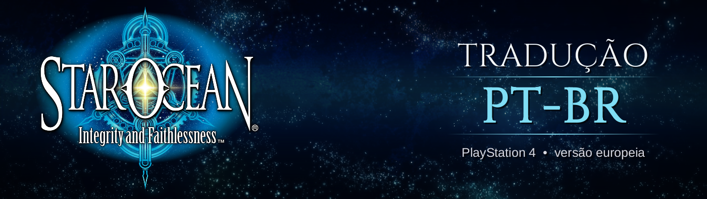
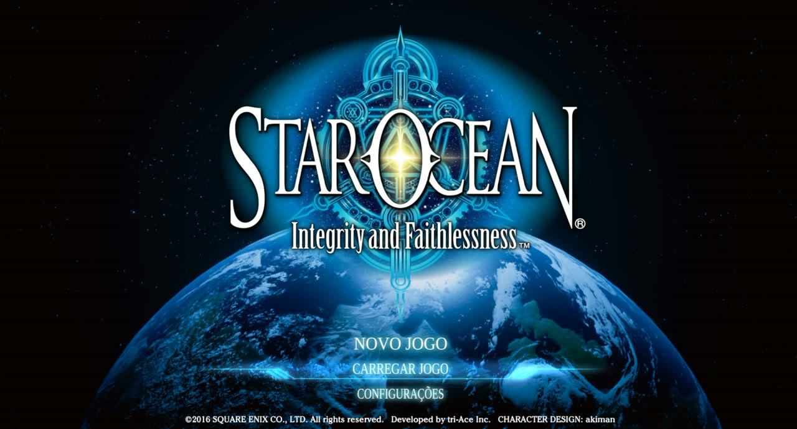
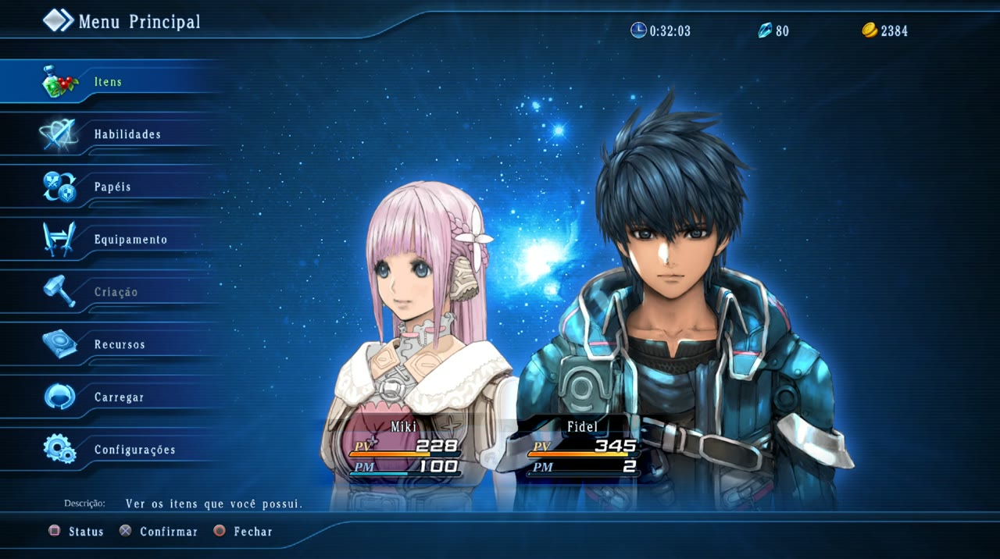
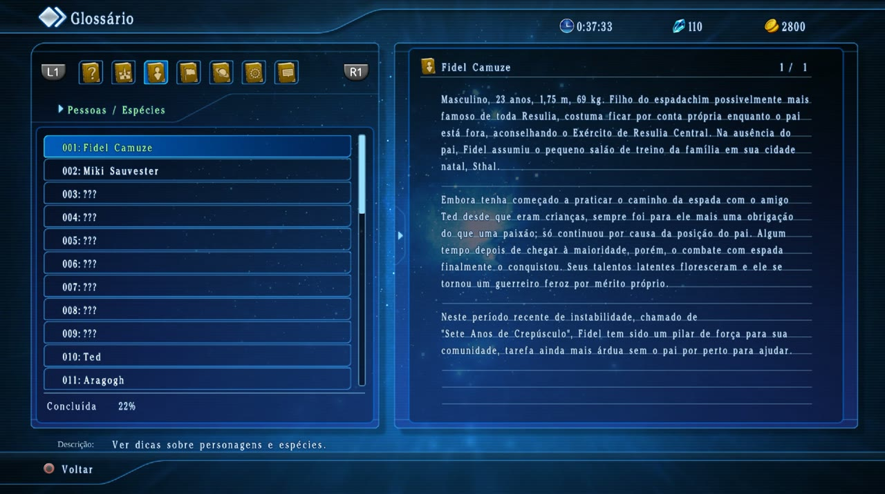
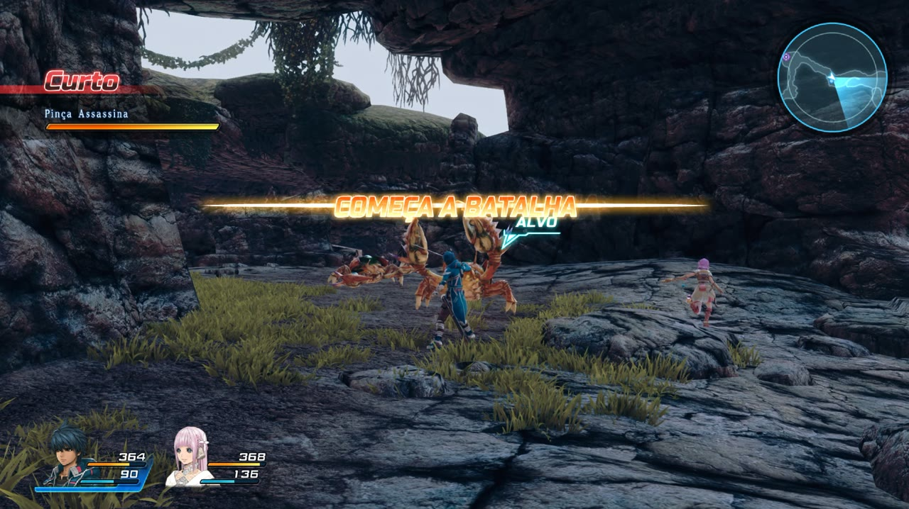
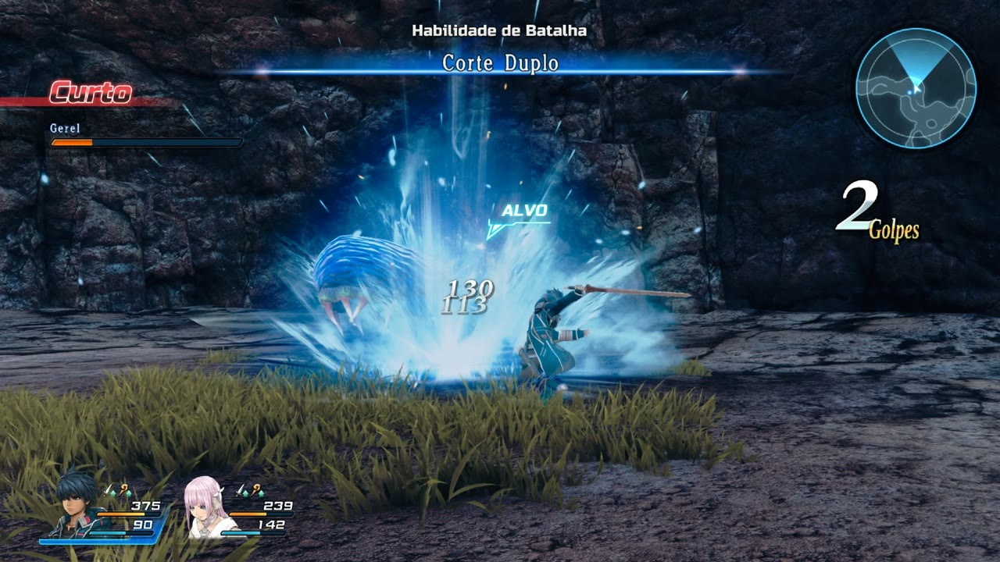
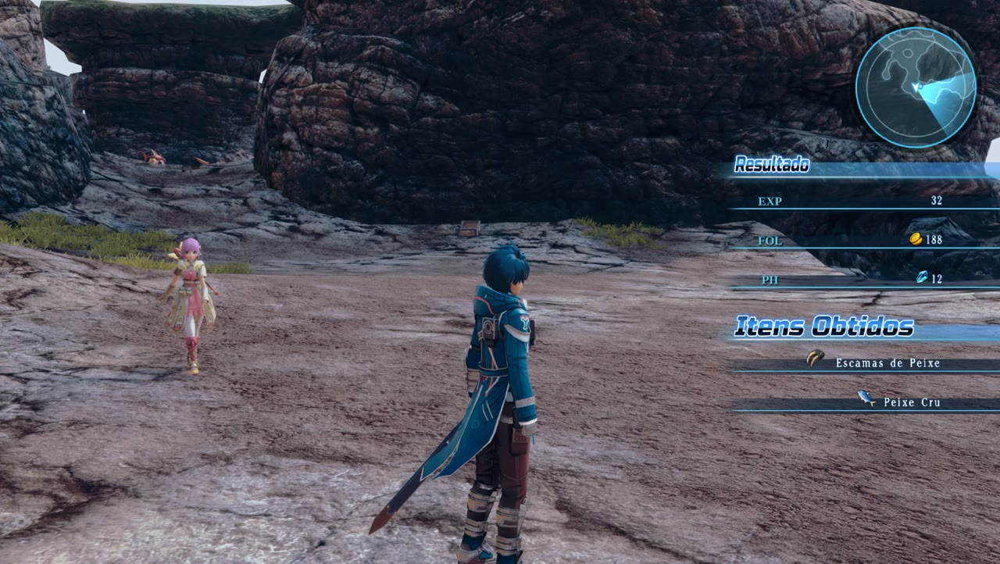

# 🌌 Star Ocean: Integrity and Faithlessness — Tradução PT-BR v1.5

-009c3b)

-555)


Tradução de fã do **Star Ocean: Integrity and Faithlessness** (PlayStation 4, versão europeia) para o
**português do Brasil**, feita para o **[Star Ocean: Integrity and Faithlessness PS4RT](https://github.com/Hoverbike51/Star-Ocean-Integrity-and-Faithlessness-PS4RT)**, a recompilação do
jogo para PC. Funciona também em **PS4 e PS5 desbloqueados**.

> 🖥️ **Esta tradução nasceu para jogar o Star Ocean traduzido no [PS4RT](https://github.com/Hoverbike51/Star-Ocean-Integrity-and-Faithlessness-PS4RT).**
> Ela troca o arquivo de idioma inglês do jogo, então serve também no PS4 e no PS5 desbloqueados (o instalador gera o
> PKG). Instale o PS4RT e descompacte o jogo antes.

*Feita por fãs, para fãs. Gratuita, sem fins lucrativos e sem nenhuma ligação com a Square Enix ou a tri-Ace
(veja o aviso legal no fim desta página).*

> ✅ História, Ações Privadas, moradores das cidades, missões, menus, itens, habilidades, dicionário e as imagens com
> texto estão em português. Testado na recompilação PS4RT do jogo e em PS4 e PS5 desbloqueados. Se achar algum
> problema, abra uma [issue](../../issues).
>
> 🇯🇵 **Na v1.4, todo o texto foi revisado de novo comparando com a versão japonesa do jogo**: nomes, descrições de
> itens, habilidades e monstros, missões e todos os diálogos. Foram corrigidos sentidos que o inglês deixava ambíguos,
> o gênero e o singular/plural de quem fala, e algumas decisões de nomes. Alturas e pesos dos perfis seguem os valores oficiais.
>
> ✏️ **Na v1.5, nomes inventados que não faziam sentido em português foram trocados** (versão Nomes Traduzidos):
> golpes Baionetaço, Martelapocalipse, Míssil de Penas, Eletrosfera e Ventosfera; monstros Bolofofo e Tratareia;
> papéis Terrassaltante, Aerobeligerante, Lumercenário e Caosmilitante. Também foi corrigido um erro de ortografia.
> Atualização de 14/11/2026: nomes de lugar da versão Nomes Originais corrigidos (iguais em todas as telas).

## 📸 Fotos

| | |
|---|---|
|  |  |
| Tela de título | Menu principal (PV e PM) |
|  |  |
| Glossário | Começo da batalha |
|  |  |
| Habilidade de batalha e combo | Resultado da batalha |

*Fotos da versão Nomes Traduzidos.*

## 📥 Download (v1.5)

**[⬇️ Baixar na página de Releases](../../releases/latest)**: tem um zip para cada sistema. Os dois trazem as **duas
versões** da tradução, o instalador, o guia `LEIA-ME.txt` e os termos de uso.

| Seu computador | Baixe |
|---|---|
| 🪟 Windows | `SO5_PTBR_v1.5_Windows.zip` |
| 🐧 Linux | `SO5_PTBR_v1.5_Linux.zip` |

| Dentro do zip | Para | SHA-256 |
|---|---|---|
| `INSTALAR_WINDOWS.bat` | Instalador do Windows (dois cliques; só no zip do Windows) | — |
| `instalar_linux.sh` | Instalador do Linux (só no zip do Linux) | — |
| `arquivos/Nomes_Traduzidos.xdelta` | Versão Nomes Traduzidos | `d97dea0c69a59a1b57c589b026727ebc0f2efcd22a1c35545327fc13fd04f360` |
| `arquivos/Nomes_Originais.xdelta` | Versão Nomes Originais | `e8125afbe69d547502bc77f3582cad9d937fc41c4d2ba197f3ede67c54989b9a` |
| `arquivos/xdelta3.exe` | Aplicador do patch (xdelta 3.0.11, GPL-2.0; só no zip do Windows) | `d81f59b2fe5e8589c0ee9782e231c805084f4d23dfade413903a4cad63b4e342` |
| `arquivos/SO5_PKG.exe` | Extrai e gera PKG no Windows (LibOrbisPkg, LGPL-3.0) | `5a90707cc1f68b34bfc672af65bed6fcfbe0d75a92e420a3ff8de8500b4a7f06` |
| `arquivos/SO5_PKG` | Extrai e gera PKG no Linux (LibOrbisPkg, LGPL-3.0) | `bcec12b0644222215334dd9f50f247b04224b7eb73e2c95b2af59dc38876df9a` |
| `arquivos/LibOrbisPkg_fonte.zip` | Código-fonte do `SO5_PKG`, com as nossas alterações | `2e5af2558d34715a6d2143650a03c561a66ffcc4aaf2eb71b8c6c4a93f2c3a0e` |

## 🎭 Duas versões: escolha a sua

| | **Nomes Traduzidos** | **Nomes Originais** |
|---|---|---|
| Menus e telas | Português | Português |
| História, diálogos, Ações Privadas e mensagens | Português | Português |
| Descrições (itens, habilidades, monstros, dicionário, missões) | Português | Português |
| Piadas e trocadilhos dentro das falas | Recriados em português | Recriados em português |
| Sineturgia (magias) | Português (*Pena de Anjo, Impacto Ártico*) | Originais (*Angel Feather, Arctic Impact*) |
| Golpes e habilidades de batalha | Português (*Portal Abissal, Chuva Ácida*) | Originais (*Abyssal Gate, Acid Rain*) |
| Itens e equipamentos | Português (*Poção de Acuidade, Cajado do Adepto*) | Originais (*Acuity Potion, Adept's Staff*) |
| Monstros | Português (*Vespa Matadora, Ceifador, Quimera Maga*) | Originais (*Killer Wasp, Grim Reaper, Mage Chimera*) |
| Papéis (Roles) | Português (*Agressor, Altruísta, Ás*) | Originais (*Aggressor, Altruist, Ace*) |
| Cidades e mapas onde se passa, inclusive os de palavra comum | Português (*Resulia Central, Castelo Bariff*) | Originais (*Central Resulia, Castle Bariff*) |
| Lojas, pousadas e casas, inclusive as de nome-trocadilho | Português (*Armaria Real, Mercadinho dos Átomos, Arsenal Come Poeira*) | Português (iguais) |
| Itens e monstros com nome-trocadilho | Recriados (*Compondo a Confusão, Homúnculo Rabugento*) | Originais (*Compounding the Issue, Grumpy Homunculus*) |
| Regiões que não são mapa (reinos, continentes, sistemas, setores, planetas citados) | Português (*Reino de Resulia, Sistema Solar*) | Português (iguais) |
| Organizações e termos do mundo | Português (*Federação Pangaláctica, Exército de Resulia Central, sineturgia*) | Português (iguais) |
| Títulos com nome (o título se traduz, o nome não) | Português (*Capitão Kenny, Comandante Dean, Doutor Krupp*) | Português (iguais) |
| Verbetes do dicionário (títulos e textos) | Português | Português (iguais) |
| Raças e tipos de nave | Português | Português (iguais) |
| Nomes próprios (Fidel, Miki, Relia, Faykreed, Sthal…) | Iguais | Iguais |
| Siglas de status | PV, PM, PH, ATQ, DEF, INT, MEN, Nv. | PV, PM, PH, ATQ, DEF, INT, MEN, Nv. |
| Imagens com texto (título, batalha, HUD, menus, controles) | Traduzidas | Originais (inglês) |

- **Nomes Traduzidos:** o jogo todo em português. Só os nomes próprios ficam como no original, mas o título que vem
  com eles se traduz ("Captain Kenny" = "Capitão Kenny").
- **Nomes Originais:** para quem joga com guia, wiki ou fórum em inglês. É igual à Nomes Traduzidos, menos o que se
  procura num guia: os nomes de **cidades e mapas, itens, equipamentos, golpes, papéis, magias e monstros** (e os
  trocadilhos dessas coisas) ficam como no original, além das imagens. Todo o resto continua em português: menus, história,
  descrições, dicionário, lojas, organizações, termos do mundo e títulos com nome. A frase em volta segue em português
  ("Fidel aprende Abyssal Gate", "o Capitão Kenny espera em Central Resulia").

As duas usam o mesmo arquivo original do jogo e os mesmos saves: dá para trocar de versão a qualquer momento.

## 🎮 O que foi traduzido

| Parte | Textos | Cobertura |
|---|---|---|
| Cenas da história, Ações Privadas e cenas extras | 6.479 | 100% |
| Moradores das cidades e das naves | 5.565 | 100% |
| Guia da história e falas do grupo durante a exploração | 682 | 100% |
| Menus, itens, habilidades, monstros, papéis, missões, dicionário, troféus de batalha, créditos | 8.807 | 100% |
| Imagens com texto | 24 texturas | todas as encontradas, menos as fotos dos tutoriais |

*As contagens incluem textos repetidos em vários lugares. Em textos diferentes, são cerca de 19 mil.*

- **Contexto da história:** cada fala foi traduzida sabendo em que ponto da aventura está, quem fala e o que cada
  personagem já sabe. Cada personagem tem o seu jeito de falar (a Relia com fala de criança, o Emmerson galanteador e
  cheio de gíria, a Fiore provocadora e rebuscada...). Quando o inglês faz piada ou trocadilho, a piada foi refeita em português.
- **Cabe na tela:** todos os textos foram medidos pixel a pixel com a fonte do próprio jogo. Foram desenhados o `ã`
  e o `Ã`, que faltavam na fonte.
- **Legendas dos vídeos:** traduzidas (o jogo desenha as legendas por cima dos vídeos).

**Fica como no original:** as vozes (inglês ou japonês), as fotos dos tutoriais (o texto do tutorial ao lado está em
português), a palavra "Pause" no menu de pausa, a linha de copyright, os nomes da equipe nos créditos e os escritos no
alfabeto inventado do jogo.

## 🧩 Requisitos

- **Star Ocean: Integrity and Faithlessness para PS4, versão europeia (CUSA03219)**, com o jogo **descompactado**
  (pasta `CUSA03219` com os arquivos `.cpk`), para usar no [PS4RT](https://github.com/Hoverbike51/Star-Ocean-Integrity-and-Faithlessness-PS4RT). Para PS4/PS5, veja a instalação no
  console.
- O jogo com o **texto em inglês** (a tradução substitui o arquivo de idioma inglês).
- O arquivo que o patch altera é **um só**, sem nenhuma alteração anterior:

  | Arquivo | Tamanho (bytes) | MD5 | SHA-1 |
  |---|---|---|---|
  | `FAI_main_ps4_LgENG_14.cpk` | 101914448 | `aa6862991338bc3f4687fb417c5b5fd0` | `2de00e17ff22ba8f4ba396a3e61abd962e1865be` |

  O instalador confere isso sozinho. A versão americana tem outro código (outro arquivo) e não é aceita.

## 💾 Instalação

Feche o jogo e o emulador antes.

**🪟 Windows**
1. Baixe o `SO5_PTBR_v1.5_Windows.zip` na página de [Releases](../../releases) e descompacte (a pasta inteira).
2. Dê dois cliques em **`INSTALAR_WINDOWS.bat`**.
3. Escolha a versão: **1** Nomes Traduzidos, **2** Nomes Originais (ou **3** para desinstalar).
4. Na janela que abrir, escolha a pasta **`CUSA03219`** do jogo.

**🐧 Linux**
1. Instale o xdelta3, se ainda não tiver: `sudo apt install xdelta3` (Debian/Ubuntu/Mint),
   `sudo dnf install xdelta` (Fedora) ou `sudo pacman -S xdelta3` (Arch/Manjaro).
2. Baixe o `SO5_PTBR_v1.5_Linux.zip`, descompacte e rode: `bash instalar_linux.sh`
3. Escolha a versão e a pasta `CUSA03219` (janela de pasta com zenity/kdialog, ou digite o caminho).

**O que o instalador faz:** acha o `FAI_main_ps4_LgENG_14.cpk` na pasta (ou nas subpastas), confere se é o original
certo, aplica a tradução, confere o resultado e **guarda o original como `FAI_main_ps4_LgENG_14.cpk.orig`**. Para
**trocar de versão** ou **desinstalar**, é só rodar o instalador de novo: ele sempre parte do `.orig`.

Depois de instalar, abra o jogo do zero. Se o emulador usa *save state*, não carregue um state antigo: ele guarda o
texto da versão anterior. Os saves normais do jogo funcionam nas duas versões.

**🎮 PS4 e PS5 desbloqueados**

No instalador do Windows ou do Linux:

| Opção | O que faz | Escolhas |
|---|---|---|
| **4** | Extrai o PKG do jogo para uma pasta nova | Nomes Traduzidos, Nomes Originais ou só extrair |
| **5** | Gera um PKG para instalar no console, a partir da pasta do jogo | Nomes Traduzidos, Nomes Originais ou o arquivo de idioma que já está na pasta |

- Cada opção precisa de **31 GB livres** em disco NTFS, exFAT ou ext4.
- A pasta do jogo e o PKG escolhido não são alterados. O `.orig` fica de fora do PKG gerado.
- O PKG gerado mantém a versão do jogo. Para levar ao console, use pen drive exFAT ou a rede.
- A opção 4 não abre PKG criptografado da PSN; nesse caso, use a pasta do jogo.
- **O PKG gerado contém o jogo inteiro: é só para o seu uso, não compartilhe.**

**Sem o instalador** (qualquer sistema), com o `xdelta3`:
```
xdelta3 -d -s FAI_main_ps4_LgENG_14.cpk.orig arquivos/Nomes_Traduzidos.xdelta FAI_main_ps4_LgENG_14.cpk
```
(renomeie antes o original para `.orig`).

| Versão | MD5 do `FAI_main_ps4_LgENG_14.cpk` traduzido |
|---|---|
| Nomes Traduzidos | `7cf7d6bf39b8f643f0e6eeb718e35e63` |
| Nomes Originais | `590207f113437aeaf5dba2d5dff10e9c` |

## 🖥️ Onde foi testado

- **[Star Ocean: Integrity and Faithlessness PS4RT](https://github.com/Hoverbike51/Star-Ocean-Integrity-and-Faithlessness-PS4RT)**
  (recompilação do jogo para PC, versão 0.4.0, Windows): as duas versões da tradução funcionam.
- **Problema conhecido do PS4RT:** na versão 0.4.0, abrir **Recursos → Troféus de Batalha** fecha o programa, também
  com o jogo original em inglês. Não é da tradução.
- **PS4 e PS5 desbloqueados:** funcionando, com o PKG gerado pelo instalador.

## ❓ Não funcionou?

| Sintoma | Causa provável |
|---|---|
| O instalador diz que o arquivo "não é o original esperado" | O jogo não é a versão europeia CUSA03219, ou o arquivo já foi alterado antes. Recoloque o original. |
| "Já é a tradução, mas o original (.orig) não está na pasta" | Alguém apagou o `.orig`. Recoloque o arquivo original do jogo e rode de novo. |
| No Linux: "o programa xdelta3 não está instalado" | Instale o xdelta3 (veja a Instalação). |
| Textos misturados ou nomes de arquivo no lugar das falas | O emulador estava aberto na troca, ou foi carregado um *save state* antigo. Feche tudo e abra o jogo do zero. |
| "Este PKG é criptografado" | O PKG é o formato da PSN, que a opção 4 não abre. Use a pasta do jogo. |
| "A unidade é FAT32" | Esse formato não aceita arquivos maiores que 4 GB. Escolha um disco NTFS, exFAT ou ext4. |
| O PS4RT fecha em Troféus de Batalha | Limitação do PS4RT 0.4.0 (acontece também em inglês). |

## 🐞 Achou um erro?

Abra uma [issue](../../issues/new/choose) usando o formulário "Erro na tradução". Informe a versão (Nomes Traduzidos ou
Nomes Originais), o lugar do jogo e, se puder, mande um print. Toda correção de português também é bem-vinda.

## 🙏 Créditos

- **Tradução, revisão, imagens e ferramentas:** [0xdhx0](https://github.com/0xdhx0).
- **[Star Ocean: Integrity and Faithlessness PS4RT](https://github.com/Hoverbike51/Star-Ocean-Integrity-and-Faithlessness-PS4RT)**, que torna possível jogar (e testar a tradução) no PC.
- **xdelta3** (aplicador do patch): Joshua MacDonald, [xdelta-gpl](https://github.com/jmacd/xdelta-gpl) (GPL-2.0).
- **LibOrbisPkg** (extração e geração de PKG): maxton, [LibOrbisPkg](https://github.com/maxton/LibOrbisPkg) (LGPL-3.0).
- **Fontes livres** usadas nas imagens: Liberation (Serif e Sans, licença OFL), Russo One e Cinzel (OFL), Arimo (Apache).

**Como foi feita:** a tradução usou ferramentas de IA. Todos os textos foram revisados com o contexto da história e o
jeito de falar de cada personagem, conferidos pixel a pixel para caber nas caixas e testados no PS4RT. Se achar uma
frase estranha, abra uma [issue](../../issues), porque toda sugestão ajuda.

## ⚖️ Aviso legal e uso

- Esta é uma **tradução feita por fãs, para fãs**, **gratuita** e **sem fins lucrativos**.
- **Não temos nenhuma ligação** com a Square Enix, a tri-Ace ou qualquer outra empresa envolvida no jogo. O projeto não
  é oficial, nem aprovado ou apoiado por elas.
- *Star Ocean: Integrity and Faithlessness* e todos os nomes, marcas e personagens pertencem aos seus donos
  (© SQUARE ENIX / tri-Ace).
- O patch contém **apenas as diferenças** em relação ao jogo original e **não funciona sem uma cópia do jogo**. Nenhum
  arquivo do jogo é distribuído aqui. Não peça nem compartilhe o jogo neste repositório.
- Pode usar e compartilhar o patch à vontade, **de graça**. Ele **não pode ser vendido** nem monetizado. Se alguém
  cobrou por ele, você foi enganado. Veja [LICENSE.txt](LICENSE.txt).
- Se você é detentor de algum direito e quer que algo seja retirado, abra uma issue ou entre em contato pelo GitHub.

Apoie a franquia comprando os jogos oficiais.
