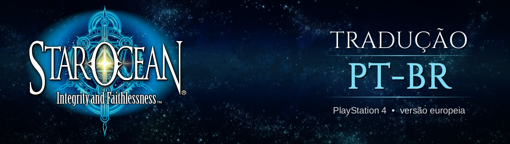
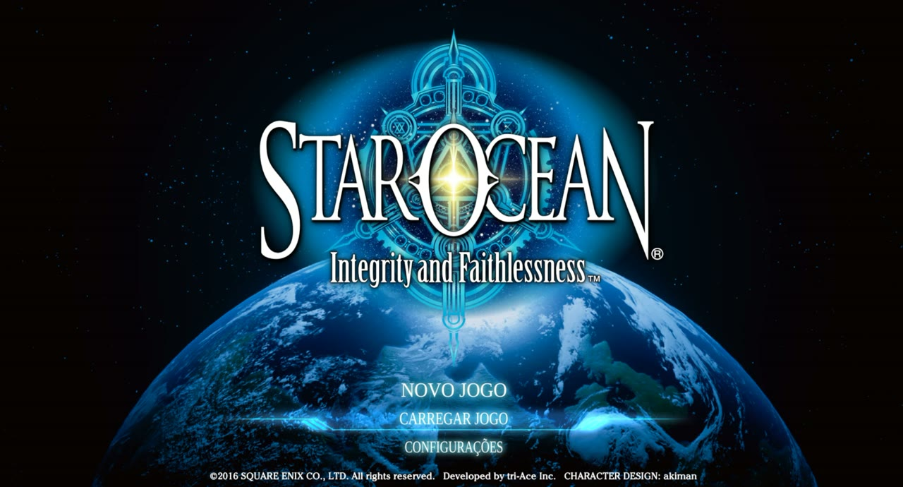
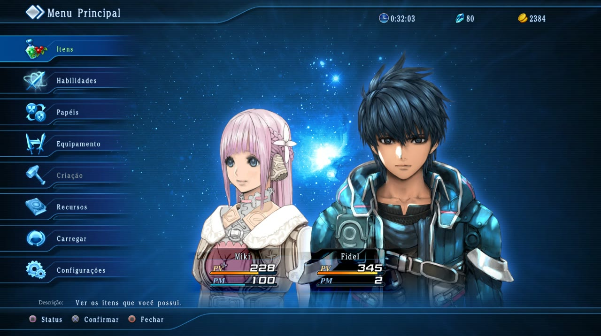
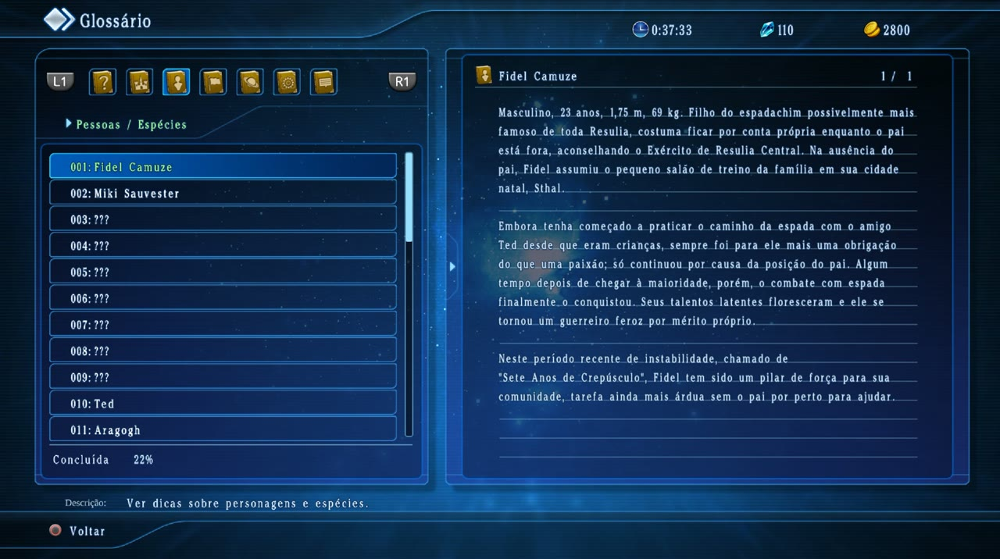
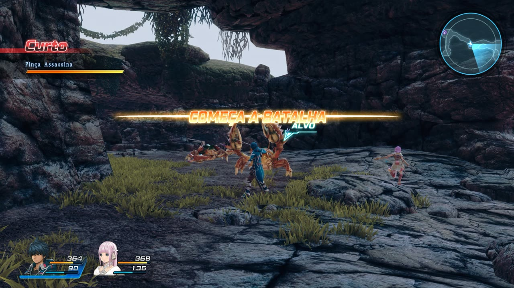
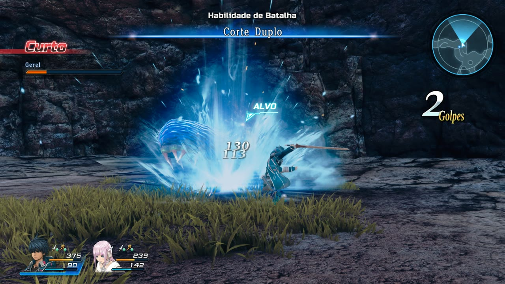
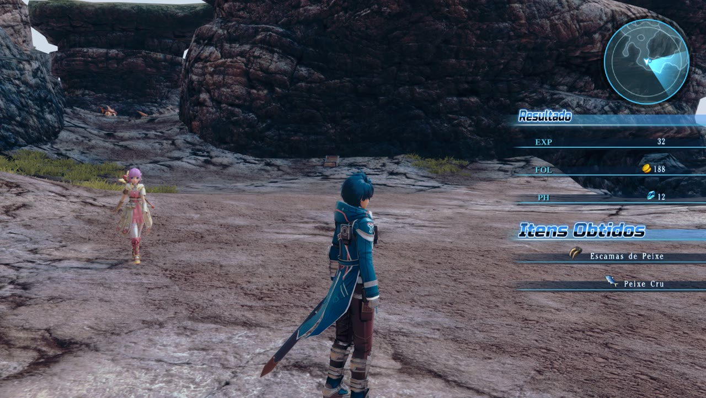

# 🌌 Star Ocean: Integrity and Faithlessness (PS4) — Tradução PT-BR

-009c3b)

-555)


Tradução de fã do **Star Ocean: Integrity and Faithlessness** (PlayStation 4, versão europeia).
**Tradução completa para o português do Brasil**, com menus, história, diálogos, magias, golpes, papéis, itens,
monstros, lugares e imagens com texto em português.

*Feita por fãs, para fãs. Gratuita, sem fins lucrativos e sem nenhuma ligação com a Square Enix ou a tri-Ace (veja o
aviso legal no fim desta página).*

> ✅ O jogo inteiro está traduzido. Se achar algum problema, abra uma [issue](../../issues).

## 🖼️ Imagens

| | |
|---|---|
|  |  |
| Tela de título | Menu principal (PV e PM) |
|  |  |
| Glossário | Começo da batalha |
|  |  |
| Habilidade de batalha e combo | Resultado da batalha |

## 📥 Download

**[⬇️ Baixar a tradução](../../releases/latest)** (página da versão mais recente). Tem um zip para cada sistema
(`_Windows.zip` e `_Linux.zip`); dentro vem o instalador, o patch, um guia `LEIA-ME.txt` e os termos de uso. Como
instalar: veja **💾 Instalação** abaixo.

## 🎮 O que foi traduzido

| Parte | Textos | Cobertura |
|---|---|---|
| Cenas da história, Ações Privadas e cenas extras | 6.479 | 100% |
| Moradores das cidades e das naves | 5.565 | 100% |
| Guia da história e falas do grupo durante a exploração | 682 | 100% |
| Menus, itens, habilidades, monstros, papéis, missões, dicionário, troféus de batalha | 8.330 | 100% |
| Imagens com texto (título, batalha, HUD, menus, controles) | 24 texturas | todas, menos as fotos dos tutoriais |

*As contagens incluem textos repetidos em vários lugares. Em textos diferentes, são cerca de 19 mil.*

- **Tudo em português:** só os nomes próprios ficam como no original (Fidel, Miki, Relia, Faykreed, Sthal...). O título
  que vem com eles se traduz ("Captain Kenny" = "Capitão Kenny").
- **Contexto da história:** cada fala foi traduzida sabendo em que ponto da aventura está, quem fala e o que cada
  personagem já sabe. Cada personagem tem o seu jeito de falar (a Relia com fala de criança, o Emmerson galanteador e
  cheio de gíria, a Fiore provocadora e rebuscada, o Oráculo solene...). Quando o inglês faz piada ou trocadilho, a
  piada foi refeita em português.
- **Cabe na tela:** todos os textos foram medidos pixel a pixel com a fonte do próprio jogo. Foram desenhados o `ã`
  e o `Ã`, que faltavam na fonte.
- **Legendas dos vídeos:** traduzidas (o jogo desenha as legendas por cima dos vídeos).
- **Interface:** PV, PM e PH no lugar de HP, MP e SP, inclusive nas imagens da batalha e do resultado.

### Alguns exemplos

- **Sineturgia (magias):** *Angel Feather → Pena de Anjo · Arctic Impact → Impacto Ártico*
- **Golpes:** *Abyssal Gate → Portal Abissal · Acid Rain → Chuva Ácida · Moonwalk → Passo Lunar*
- **Papéis:** *Aggressor → Agressor · Altruist → Altruísta · tri-Ace → Triplo Ás*
- **Monstros:** *Killer Wasp → Vespa Matadora · Grim Reaper → Ceifador · Treant → Ente · Baskania → Mau-Olhado*
- **Itens e equipamentos:** *Acuity Potion → Poção de Acuidade · Farwell → Lâmina do Adeus*
- **Lugares:** *Central Resulia → Resulia Central · Castle Bariff → Castelo Bariff*

## 🚫 O que não foi traduzido (de propósito)

| O quê | Por quê |
|---|---|
| Nomes próprios (Fidel, Miki, Relia, Faykreed, Sthal, Charles D. Goale…) | São nomes, iguais em todas as versões do jogo. |
| Créditos finais (cargos e nomes da equipe) | Ficam como no original. |
| Fotos dos tutoriais | São capturas da tela do jogo; o texto do tutorial ao lado está em português. |
| A palavra "Pause" no menu de pausa | A imagem é a mesma em todos os idiomas do jogo. |
| Logotipo, subtítulo ("Integrity and Faithlessness") e copyright | Arte e marcas registradas. |
| Escritos no alfabeto inventado do jogo | Fazem parte da arte. |
| Vozes | Ficam as vozes originais (inglês ou japonês). |

## 💿 O que você precisa

Você precisa da sua **própria cópia** do jogo para PS4, versão **europeia (CUSA03219)**, com o **texto em inglês** (a
tradução substitui o arquivo de idioma inglês). **Este projeto não distribui o jogo.**

- Para jogar no PC: o **[Star Ocean: Integrity and Faithlessness PS4RT](https://github.com/Hoverbike51/Star-Ocean-Integrity-and-Faithlessness-PS4RT)**
  (recompilação do jogo para PC) com o jogo **descompactado** (pasta `CUSA03219` com os arquivos `.cpk`).
- Para jogar no console: PS4 ou PS5 desbloqueado (o instalador gera o PKG).
- O arquivo que o patch altera é **um só**, sem nenhuma alteração anterior:

  | Arquivo | Tamanho (bytes) | MD5 | SHA-1 |
  |---|---|---|---|
  | `FAI_main_ps4_LgENG_14.cpk` | 101914448 | `aa6862991338bc3f4687fb417c5b5fd0` | `2de00e17ff22ba8f4ba396a3e61abd962e1865be` |

  O instalador confere isso sozinho. A versão americana tem outro código (outro arquivo) e não é aceita.

## 💾 Instalação

Feche o jogo antes.

**🪟 Windows**
1. Baixe o zip `_Windows.zip` na página de [Releases](../../releases/latest) e descompacte (a pasta inteira).
2. Dê dois cliques em **`INSTALAR_WINDOWS.bat`** e escolha **1** (instalar).
3. Na janela que abrir, escolha a pasta **`CUSA03219`** do jogo.

**🐧 Linux**
1. Instale o xdelta3, se ainda não tiver: `sudo apt install xdelta3` (Debian/Ubuntu/Mint),
   `sudo dnf install xdelta` (Fedora) ou `sudo pacman -S xdelta3` (Arch/Manjaro).
2. Baixe o zip `_Linux.zip`, descompacte e rode: `bash instalar_linux.sh`
3. Escolha **1** e a pasta `CUSA03219` (janela de pasta com zenity/kdialog, ou digite o caminho).

**O que o instalador faz:** acha o `FAI_main_ps4_LgENG_14.cpk` na pasta (ou nas subpastas), confere se é o original
certo, aplica a tradução, confere o resultado e **guarda o original como `FAI_main_ps4_LgENG_14.cpk.orig`**. Para
**atualizar** a partir de qualquer versão anterior, é só instalar de novo: ele sempre parte do `.orig`. Para
**desinstalar**, rode o instalador e escolha **2**.

Depois de instalar, abra o jogo do zero. Se usar *save state*, não carregue um state antigo: ele guarda o texto
da versão anterior. Os saves normais do jogo continuam funcionando.

**🎮 PS4 e PS5 desbloqueados**

No instalador do Windows ou do Linux:

| Opção | O que faz | Escolhas |
|---|---|---|
| **3** | Extrai o PKG do jogo para uma pasta nova | Com a tradução ou só extrair |
| **4** | Gera um PKG para instalar no console, a partir da pasta do jogo | Aplicar a tradução ou usar o arquivo de idioma que já está na pasta |

- Cada opção precisa de **31 GB livres** em disco NTFS, exFAT ou ext4.
- A pasta do jogo e o PKG escolhido não são alterados. O `.orig` fica de fora do PKG gerado.
- O PKG gerado mantém a versão do jogo. Para levar ao console, use pen drive exFAT ou a rede.
- A opção 3 não abre PKG criptografado da PSN; nesse caso, use a pasta do jogo.
- **O PKG gerado contém o jogo inteiro: é só para o seu uso, não compartilhe.**

**Sem o instalador** (qualquer sistema), com o `xdelta3` (renomeie antes o original para `.orig`):
```
xdelta3 -d -s FAI_main_ps4_LgENG_14.cpk.orig arquivos/SO5_PTBR.xdelta FAI_main_ps4_LgENG_14.cpk
```
O MD5 esperado do arquivo traduzido está em `arquivos/md5.txt`.

## 🔒 Segurança

- Baixe a tradução **só pela página de [Releases](../../releases) deste repositório**.
- O zip traz o `SHA256SUMS.txt` com o código de cada arquivo, e o instalador confere o MD5 do original e do resultado
  antes de trocar qualquer coisa.
- O instalador não apaga o original: ele fica guardado como `.orig` na pasta do jogo.

## ❓ Não funcionou?

| Sintoma | Causa provável |
|---|---|
| O instalador diz que o arquivo "não é o original esperado" | O jogo não é a versão europeia CUSA03219, ou o arquivo já foi alterado antes. Recoloque o original. |
| "Já é a tradução, mas o original (.orig) não está na pasta" | Alguém apagou o `.orig`. Recoloque o arquivo original do jogo e rode de novo. |
| No Linux: "o programa xdelta3 não está instalado" | Instale o xdelta3 (veja a Instalação). |
| Textos misturados ou nomes de arquivo no lugar das falas | O jogo estava aberto na troca, ou foi carregado um *save state* antigo. Feche tudo e abra o jogo do zero. |
| "Este PKG é criptografado" | O PKG é o formato da PSN, que a opção 3 não abre. Use a pasta do jogo. |
| "A unidade é FAT32" | Esse formato não aceita arquivos maiores que 4 GB. Escolha um disco NTFS, exFAT ou ext4. |
| Travamento | Abra uma issue informando onde aconteceu. |

## 🐞 Achou um erro?

Abra uma [issue](../../issues/new/choose) usando o formulário "Erro na tradução". Informe a versão do patch, o lugar do
jogo e, se puder, mande um print. Toda correção de português também é bem-vinda.

## 🙏 Créditos

- **Tradução, revisão, imagens e ferramentas:** [0xdhx0](https://github.com/0xdhx0).
- **[Star Ocean: Integrity and Faithlessness PS4RT](https://github.com/Hoverbike51/Star-Ocean-Integrity-and-Faithlessness-PS4RT)**, que torna possível jogar (e testar a tradução) no PC.
- **xdelta3** (aplicador do patch): Joshua MacDonald, [xdelta-gpl](https://github.com/jmacd/xdelta-gpl) (GPL-2.0).
- **LibOrbisPkg** (extração e geração de PKG): maxton, [LibOrbisPkg](https://github.com/maxton/LibOrbisPkg) (LGPL-3.0).
- **Fontes livres** usadas nas imagens: Liberation (Serif e Sans, licença OFL), Russo One e Cinzel (OFL), Arimo (Apache).

**Como foi feita:** a tradução usou ferramentas de IA. Todos os textos foram revisados com o contexto da história e o
jeito de falar de cada personagem, conferidos pixel a pixel para caber nas caixas e testados no jogo. Se achar uma
frase estranha, abra uma [issue](../../issues), porque toda sugestão ajuda.

## ⚖️ Aviso legal e uso

- Esta é uma **tradução feita por fãs, para fãs**, **gratuita** e **sem fins lucrativos**.
- **Não temos nenhuma ligação** com a Square Enix, a tri-Ace ou qualquer outra empresa envolvida no jogo. O projeto não
  é oficial, nem aprovado ou apoiado por elas.
- *Star Ocean: Integrity and Faithlessness* e todos os nomes, marcas e personagens pertencem aos seus donos
  (© SQUARE ENIX / tri-Ace).
- O patch contém **apenas as diferenças** em relação ao jogo original e **não funciona sem uma cópia do jogo**. Nenhum
  arquivo do jogo é distribuído aqui. Não peça nem compartilhe o jogo neste repositório.
- Pode usar e compartilhar o patch à vontade, **de graça**. Ele **não pode ser vendido** nem monetizado. Se alguém
  cobrou por ele, você foi enganado. Veja [LICENSE.txt](LICENSE.txt).
- Se você é detentor de algum direito e quer que algo seja retirado, abra uma issue ou entre em contato pelo GitHub.

Apoie a franquia comprando os jogos oficiais.
